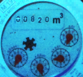
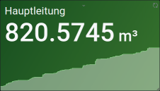
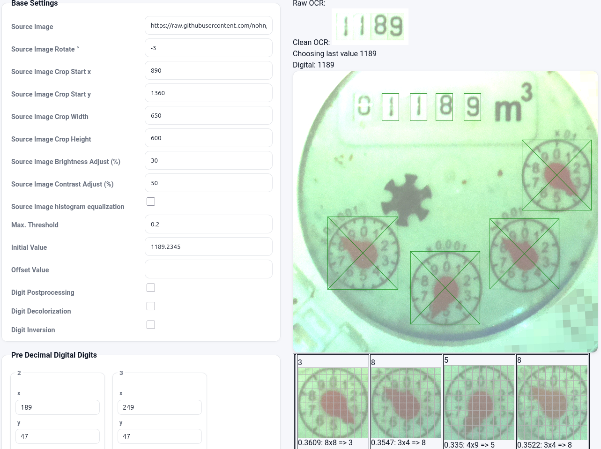

# Read a water meter and returns value

Reads analog water meters and provides a web service that returns the read value as decimal. The needles of the analog gauges currently have to be red.

Turns  into ```820.5745``` so it can become .

[](https://github.com/nohn/watermeter/actions/workflows/ci.yml?query=branch%3Amain) [](https://hub.docker.com/r/nohn/watermeter/tags?page=1&ordering=last_updated)

Please note, that this is not able to read 7-segment-displays. If you are using Home Assistant and want to read 7-segment-displays, you may want to take a look at the [native 7 segments integration](https://www.home-assistant.io/integrations/seven_segments/).

## Getting Started

This is only a quick introduction to setting up and configuring watermeter. A more extensive documentation can be found in [the howto](doc/HOWTO.md).

### Installation

#### Using Podman Compose and Docker Hub (recommended)

```yaml
version: "3.5"
services:
  watermeter:
    image: nohn/watermeter:latest
    container_name: watermeter
    volumes:
      - ./watermeter/config:/usr/src/watermeter/src/config
    restart: always
    ports:
      - "3000:3000"
```

Save this configuration as `compose.yml` and start it with `podman-compose up -d`.

#### As Home Assistant App (Addon)

This can also be installed as [Home Assistant Addon](https://github.com/nohn/watermeter).

#### Building locally

If you want to build the Container image locally, you can use the following command:

```bash
podman build . -t nohn/watermeter
```

### Configuration

You can access the configuration tool http://watermeter:3000/configure.php. The interface should be self explanatory. Source Image can be either in local filesystem or any HTTP(S) resource.



After configuration is done, you can access the current value at

    http://watermeter:3000/

or

    http://watermeter:3000/?json

or see debug information at

    http://watermeter:3000/?debug

## How to contribute

### Contributing

You can contribute to this project by:

* Opening an [Issue](https://github.com/nohn/watermeter/issues) if you found a bug or wish to propose a new feature
* Placing a [Pull Request](https://github.com/nohn/watermeter/pulls) with bugfixes, new features etc.

### Running tests locally in Podman (recommended)

OCR fine tuning depends on the specific tesseract version. It is therefore recommended to run the tests in a container with the same tesseract version as the one used in production:

```
podman build . --target dev --no-cache
```

### Running tests locally

The reader tests require the Tesseract executable and English language data, in addition to the Composer dependencies. The PHP Tesseract package is a wrapper and does not install the executable. On Debian or Ubuntu, install them with:

```bash
sudo apt-get install tesseract-ocr tesseract-ocr-eng
```

Confirm `tesseract --version` works in the same environment as PHP, then run `vendor/bin/phpunit tests`. If Tesseract is missing from `PATH`, the reader reports an OCR error and falls back to the integer part of the last known reading for the digital digits.

To execute tests run

```bash
vendor/bin/phpunit 
```

## License

watermeter is released under the [GNU Affero General Public License](LICENSE).